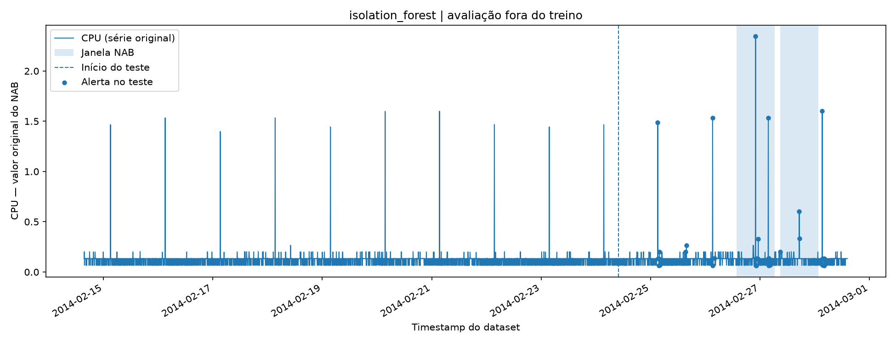
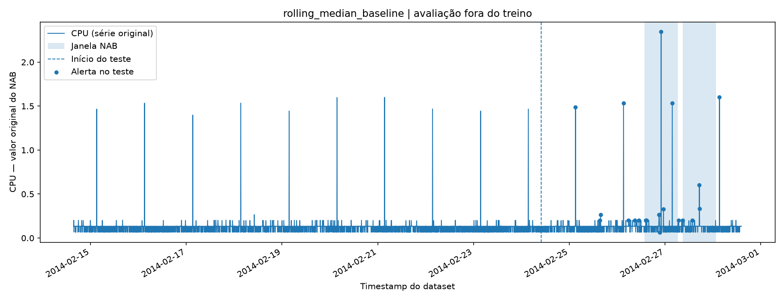

# Service Anomaly ML

[Leia em português](README.pt-BR.md) · English

**A reproducible time-series anomaly-detection experiment, built with Python and scikit-learn.**

> Status: experimental baseline. This repository does **not** claim a production-ready detector, a validated causal explanation, an official Numenta Anomaly Benchmark (NAB) score, or generalization across datasets.

## Research question

Can an unsupervised Isolation Forest flag annotated temporal anomalies in a cloud CPU-utilization series, and how does it compare with a simple historical rolling-median deviation rule at the **same training-calibrated alert budget**?

## Data provenance

Source: Numenta Anomaly Benchmark, [`realAWSCloudwatch/ec2_cpu_utilization_24ae8d.csv`](https://github.com/numenta/NAB/blob/master/data/realAWSCloudwatch/ec2_cpu_utilization_24ae8d.csv). Ground-truth tolerance windows: [`labels/combined_windows.json`](https://github.com/numenta/NAB/blob/master/labels/combined_windows.json). Numenta also publishes [`combined_labels.json`](https://github.com/numenta/NAB/blob/master/labels/combined_labels.json), which contains point annotations distinct from scoring windows.

The original series has **4,032 observations**, columns `timestamp` and `value`, and **two annotated windows**. Those counts were inspected during local dataset preparation; the training script independently validates all files. **Raw data is not bundled in this project.** Keep upstream attribution and obey its license before any redistribution.

Suggested citation: Ahmad, S., Lavin, A., Purdy, S., & Agha, Z. (2017). *Unsupervised real-time anomaly detection for streaming data.* Neurocomputing. https://doi.org/10.1016/j.neucom.2017.04.070

## Reproducible setup — Windows PowerShell

Start in the project directory:

```powershell
.\.venv\Scripts\Activate.ps1
python -m pip install --no-deps -e .
python -m pytest -q
python -m service_anomaly_ml.train
python -m service_anomaly_ml.evaluate
```

This assumes the dependencies from your existing `requirements.txt` are installed and the two upstream files are already in the paths shown below. To recreate the environment elsewhere, run `py -3 -m venv .venv`, activate it and `python -m pip install -e ".[dev]"` (or install pinned dependencies from `requirements.txt` first).

### Required local files

```text
data/
  raw/realAWSCloudwatch/ec2_cpu_utilization_24ae8d.csv
  labels/combined_windows.json
```

Download source data in PowerShell:

```powershell
New-Item -ItemType Directory -Force -Path 'data/raw/realAWSCloudwatch','data/labels' | Out-Null
Invoke-WebRequest 'https://raw.githubusercontent.com/numenta/NAB/master/data/realAWSCloudwatch/ec2_cpu_utilization_24ae8d.csv' -OutFile 'data/raw/realAWSCloudwatch/ec2_cpu_utilization_24ae8d.csv'
Invoke-WebRequest 'https://raw.githubusercontent.com/numenta/NAB/master/labels/combined_windows.json' -OutFile 'data/labels/combined_windows.json'
```

## Methodology

1. **Chronological split** of causal feature rows: 70% training, 30% later test; do not shuffle.
2. **Causal features** from the current CPU measurement and the preceding twelve samples. Historical aggregate features use `.shift(1)`; the first 12 observations are discarded.
3. **Isolation Forest** with 200 trees, `random_state=42`, and `StandardScaler`, fitted only to training features. The anomaly score is `-score_samples`: larger = more anomalous.
4. **Statistical baseline**: absolute deviation of current CPU value from the preceding 12-observation rolling median.
5. **Threshold calibration**: independently choose the 98th percentile of each training score distribution. Test labels/windows are not used to pick the thresholds.
6. **Holdout evaluation**: a hit means at least one alert in a corresponding NAB annotation window; count off-window alert points and contiguous off-window alert episodes. The detector is **not** re-trained on test data.
7. **Persistence**: save an sklearn pipeline as `skops` plus JSON with experiment metadata, CSV with holdout predictions and two PNG graphs. The original data is not changed.

**Important evaluation caveat:** NAB windows are tolerance intervals for temporal detections; they are *not* proof that every point inside a window is anomalous. This project intentionally does **not** compute pointwise precision/F1 using all window contents as positive labels. Its event recall is **not the official normalized NAB score** and cannot be compared with the official NAB leaderboard.

With only two annotated windows in one CPU series, event recall has high uncertainty; the project is a methodological baseline, not evidence of generalization. Treat a comparison with the rolling-median rule as exploratory. Expanding to multiple independent series and official NAB scoring should precede any production claim.

## Observed results — experiment 01 (November 2026)

The following measurements are from a **real local training run**, verified by `python -m service_anomaly_ml.evaluate`. The exported `skops` pipeline was subsequently loaded from the author's local training output and its scores and alert flags reproduced exactly (`True` / `True`). Those checks do not establish generalization.

| Measurement | Isolation Forest | Rolling-median baseline |
|---|---:|---:|
| Annotated windows hit | 2 / 2 | 2 / 2 |
| Event recall on the 2 windows | 1.0 | 1.0 |
| Off-window alert points | 23 | **9** |
| Off-window alert episodes | 9 | 9 |
| Total test alert points | 46 | 21 |
| Test alert rate | 3.8143% | 1.7413% |

**Dataset:** 4,032 original observations; 4,020 rows with complete causal features; 2,814 training rows and 1,206 chronological holdout rows. Both methods found at least one alert within each annotated window, but the rolling-median baseline produced fewer alert points outside the windows. The same number of off-window episodes (nine each) means the improvement is in point count, not episode count. Off-window points are *proxy false alerts relative to the supplied windows*, not verified ground-truth false positives.





Read the [experiment report](docs/results/EXPERIMENT_01.md), [machine-readable experiment metadata](docs/results/experiment.json), and [draft Hugging Face model card](docs/huggingface/MODEL_CARD.md). The model has **not been published to Hugging Face** in this repository version. Publication instructions are in [the release guide](docs/HUGGING_FACE_RELEASE.md).

## Generated files (ignored by Git)

```text
artifacts/
  isolation_forest.skops          # model pipeline (load only from trusted provenance)
  experiment.json                # split, thresholds, dataset SHA-256, package version, metrics
  test_predictions.csv           # test-only scores and flags
  isolation_forest.png           # CPU, windows and model alerts
  rolling_median_baseline.png    # CPU, windows and baseline alerts
```

Review `artifacts/experiment.json` for the configuration and results of **your own run**. The experimental results above describe the author’s November 2026 run and should not be presented as invariant across environments. The evaluation command recomputes window detection from saved predictions and checks consistency with the report; it does not re-train.

## Security and reproducibility

- Public sources only; do not include corporate API logs or customer data.
- The `.venv/`, raw data, processed data and trained `artifacts/` paths belong in `.gitignore`.
- The `skops` model is meant for a later Hugging Face model repository after reviewing model types and model card. Do not deserialize untrusted model files.
- Package versions are recorded via `requirements.txt` and scikit-learn/Python versions in `experiment.json`; data hashes provide traceability.
- The CI workflow runs synthetic unit tests only; it does not claim the real-dataset experiment ran in CI.

## Planned improvements

- Reproduce the official NAB event scoring using its scoring implementation.
- Evaluate additional datasets and series without tuning to the held-out test set.
- Design separate training, validation and test periods for hyperparameter search.
- Produce a model card and publish the validated artifact to Hugging Face, then consider an inference API.

See [Experimental design](docs/EXPERIMENT_DESIGN.md).

## Multi-Series Evaluation

A reproducible evaluation across 17 NAB AWS CloudWatch time series, comparing Isolation Forest and a rolling-median baseline.

[View experimental results](docs/results/multi_series/MULTI_SERIES_REPORT.md)

## Exploratory Data Drift Analysis (v0.3.0)

Distribution-shift diagnostics across 17 NAB AWS CloudWatch time series, using PSI and KS distance.

[Read the drift report](docs/results/drift/DRIFT_REPORT.md)
