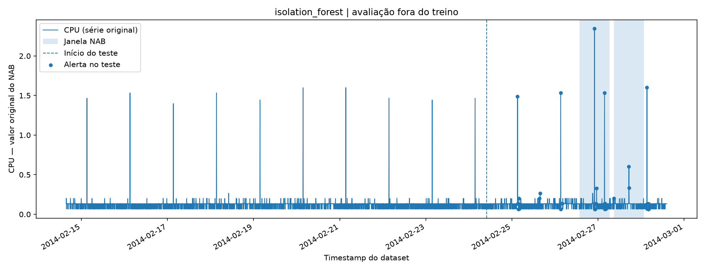
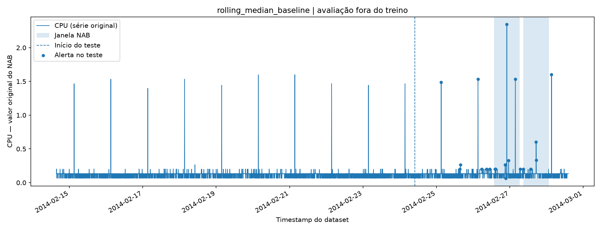

# Service Anomaly ML — Guia em português

Este projeto é um experimento **reproduzível de aprendizado de máquina (Machine Learning)**. O objetivo é treinar um modelo `IsolationForest` para detectar comportamentos incomuns em uma série temporal pública de utilização de CPU e compará-lo com um detector estatístico simples.

**Estado atual:** versão experimental, com treinamento real e avaliação local reproduzidos em novembro de 2026. O modelo ainda não foi publicado no Hugging Face. Os resultados abaixo representam uma execução específica, não uma garantia de desempenho.

## O que já existe

- Código Python organizado em módulos, com testes automatizados.
- Preparação de atributos (*features*) usando apenas a observação atual e observações anteriores.
- Divisão cronológica entre treinamento (70%) e teste (30%).
- Modelo `IsolationForest` (200 árvores, semente 42) com normalização aprendida apenas no treino.
- Método de referência: desvio absoluto em relação à mediana das últimas 12 observações anteriores.
- Limiares definidos pelo percentil 98 dos scores **do treino**, não pelos rótulos de teste.
- Métricas de detecção por janela e contagem de falsos alertas fora das janelas.
- Saída com modelo `skops`, JSON, CSV de previsões e gráficos PNG.

## Executar no PowerShell

Você já criou `C:\Users\Computer\Desktop\service-anomaly-ml`, instalou Python e as bibliotecas e baixou os dois arquivos do NAB. Basta acrescentar o conteúdo do ZIP à raiz dessa pasta (sem apagar `data/`, `.venv/` ou `requirements.txt`).

```powershell
cd "C:\Users\Computer\Desktop\service-anomaly-ml"
.\.venv\Scripts\Activate.ps1
python -m pip install --no-deps -e .
python -m pytest -q
python -m service_anomaly_ml.train
python -m service_anomaly_ml.evaluate
```

O comando `pip install -e . --no-deps` registra o pacote Python local no ambiente virtual **sem reinstalar** os pacotes já instalados. O pacote foi escrito para funcionar no Python 3.13. As dependências já instaladas incluem pandas, scikit-learn, matplotlib, pytest e skops.

O comando `pytest` executa testes **com dados sintéticos**, sem precisar acessar a internet. O comando `train` acessa os dados reais já baixados, aprende o modelo e salva o relatório. O comando `evaluate` refaz a contagem dos eventos usando as previsões salvas, sem treinar novamente.

## Entradas locais

```text
data/raw/realAWSCloudwatch/ec2_cpu_utilization_24ae8d.csv
data/labels/combined_windows.json
```

Não modifique os arquivos originais; eles são checados e identificados por SHA-256 nos metadados do experimento.

## Saídas locais

```text
artifacts/isolation_forest.skops
artifacts/experiment.json
artifacts/test_predictions.csv
artifacts/isolation_forest.png
artifacts/rolling_median_baseline.png
```

A pasta `artifacts/` já está ignorada pelo seu `.gitignore`. Não publique um modelo ainda sem examinar resultados, documentação e segurança. Também não é recomendável incluir arquivos de dados internos de empresas neste repositório.

## Como interpretar os resultados

No terminal, a contagem `eventos X/2` significa que o detector gerou ao menos um alerta dentro de X das duas janelas anotadas do dataset. `Falsos alertas fora das janelas` indica alertas que ficaram fora desses intervalos, apresentados tanto como quantidade de pontos quanto como sequências contíguas.

**Não significa que todos os pontos dentro da janela sejam anômalos.** As janelas foram definidas pelo NAB para tolerância temporal em detecções. Por isso, não calculamos um F1-score por ponto classificando a janela inteira como positiva. As métricas usadas aqui **não são a pontuação oficial NAB**.

Com somente duas janelas de anomalia e uma única série de CPU, qualquer resultado é preliminar. Mesmo se aparecer `2/2`, isso não comprova generalização nem desempenho adequado em produção. O próximo passo científico é avaliar outras séries temporais e, depois, reproduzir a métrica oficial do benchmark.

## Resultados medidos — experimento 01 (novembro de 2026)

Os números abaixo foram obtidos **executando o treinamento com a série original do NAB**, reproduzindo a avaliação com `python -m service_anomaly_ml.evaluate` e validando o carregamento do arquivo `skops`: os scores e os alertas foram reproduzidos (`True` e `True`).

| Métrica | Isolation Forest | Baseline da mediana móvel |
|---|---:|---:|
| Janelas anotadas detectadas | 2 / 2 | 2 / 2 |
| Recall por evento (somente 2 janelas) | 1,0 | 1,0 |
| Pontos de alerta fora das janelas | 23 | **9** |
| Episódios de alerta fora das janelas | 9 | 9 |
| Total de pontos sinalizados no teste | 46 | 21 |
| Taxa de alerta no teste | 3,8143% | 1,7413% |

**Divisão:** 4.032 observações originais; 4.020 linhas após gerar atributos causais; 2.814 de treino e 1.206 de teste cronológico. O baseline gerou menos *pontos* de alerta fora das janelas, mas ambos tiveram nove *episódios* de alerta fora delas. Um alerta fora da janela é uma **aproximação para falso alerta conforme as anotações disponíveis**, não uma prova de que a observação seja normal.





Consulte o [relatório do experimento](docs/results/EXPERIMENT_01.md), o [JSON de resultados reais](docs/results/experiment.json), o [Model Card proposto](docs/huggingface/MODEL_CARD.md) e o [guia de publicação no Hugging Face](docs/HUGGING_FACE_RELEASE.md).

**Importante:** nenhuma dessas métricas é a pontuação oficial do NAB. Duas janelas de uma única série não são suficientes para comprovar generalização ou segurança operacional.

## Estrutura

```text
service-anomaly-ml/
  src/service_anomaly_ml/
    data.py         # Leitura e checagem dos dados/anotações
    features.py     # Atributos construídos de modo causal
    evaluation.py   # Métricas de evento e falsos alertas
    train.py        # Treino, comparação e exportação
    evaluate.py     # Reavaliação das previsões salvas
  tests/             # Testes com dados sintéticos
  docs/              # Metodologia, limitações e referências
  pyproject.toml     # Declaração do pacote Python
  .github/workflows/ # CI dos testes unitários
```

## Fontes científicas e técnicas

- [Numenta Anomaly Benchmark](https://github.com/numenta/NAB)
- [Anotações de janelas](https://github.com/numenta/NAB/blob/master/labels/combined_windows.json)
- [Anotações pontuais](https://github.com/numenta/NAB/blob/master/labels/combined_labels.json)
- [Documentação do IsolationForest](https://scikit-learn.org/stable/modules/generated/sklearn.ensemble.IsolationForest.html)
- Ahmad, S. et al. (2017), *Unsupervised real-time anomaly detection for streaming data*, Neurocomputing. DOI: https://doi.org/10.1016/j.neucom.2017.04.070

Para metodologia e riscos de validade, consulte [docs/EXPERIMENT_DESIGN.md](docs/EXPERIMENT_DESIGN.md).

## Avaliacao com multiplas series temporais

Experimento reproduzivel com 17 series AWS CloudWatch do NAB, comparando Isolation Forest e um detector estatistico baseado em mediana movel.

[Consultar resultados](docs/results/multi_series/MULTI_SERIES_REPORT.md)

## Diagnostico exploratorio de Data Drift (v0.3.0)

Analise de mudancas de distribuicao em 17 series temporais do NAB, utilizando PSI e distancia KS.

[Consultar relatorio de drift](docs/results/drift/DRIFT_REPORT.md)
