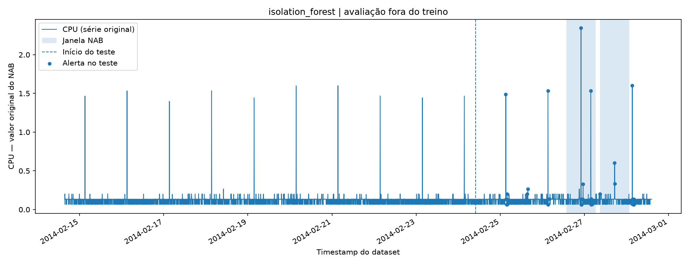
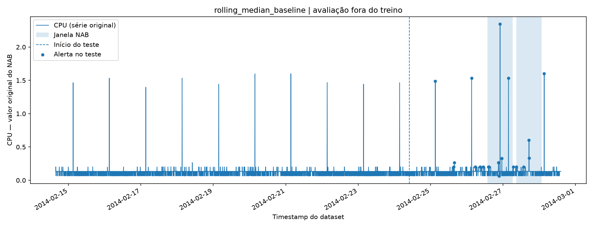

# Experiment 01 — AWS EC2 CPU anomaly detection

**Status:** completed local experiment; model and predictions independently reloaded and rechecked. **Not official NAB scoring.**

## Provenance and setup

- Data: Numenta Anomaly Benchmark (NAB), `realAWSCloudwatch/ec2_cpu_utilization_24ae8d.csv` and `labels/combined_windows.json` ([upstream repository](https://github.com/numenta/NAB)). Dataset and labels hashes are recorded in `experiment.json` for this run.
- Source observations: **4,032**; complete-feature observations: **4,020**; chronological training rows: **2,814**; chronological holdout rows: **1,206**.
- Feature engineering: 7 attributes including current measurement, one-step differences, and historical 12-sample rolling aggregates. A `.shift(1)` ensures rolling features depend only on past measurements.
- Unsupervised model: `StandardScaler` followed by `IsolationForest(n_estimators=200, contamination='auto', random_state=42)`. The anomaly score is the negative of `score_samples`.
- Baseline: absolute deviation from the median of the prior 12 CPU observations.
- Calibration: the **98th percentile of training scores** for each detector separately; the test labels did not determine thresholds.
- Evaluation: a window is detected when it contains at least one model alert. Reports off-window alert **points** and consecutive alert **episodes**, which are not identical measures.

## Local measurements

| Metric | Isolation Forest | Rolling-median baseline |
|---|---:|---:|
| Windows evaluated / detected | 2 / 2 | 2 / 2 |
| Event recall | 1.0 | 1.0 |
| Off-window alert points | 23 | 9 |
| Off-window alert episodes | 9 | 9 |
| Total holdout alert points | 46 | 21 |
| Holdout alert rate | 0.038143 | 0.017413 |

The baseline produced fewer off-window alert **points**, while the detectors had the **same number of off-window episodes**. A sample outside an annotation window is not automatically a confirmed normal observation; these are window-relative proxy false-alert metrics.





[Experiment metadata and data hashes](experiment.json).

## Reproduction

From the repository root with dependencies installed and the original NAB source files downloaded:

```powershell
python -m pytest -q
python -m service_anomaly_ml.train
python -m service_anomaly_ml.evaluate
```

Observed locally: **11 tests passed**; re-running the evaluation reproduced both detectors' reported metrics. The author separately loaded the author-generated `artifacts/isolation_forest.skops` after narrowly trusting `sklearn.tree._tree.Tree`, and verified that re-generated anomaly scores and flags matched the stored predictions.

## Limitations / validity threats

1. **Sample size:** one series and two annotated events; a 2/2 recall is not a reliable estimate of generalization.
2. **Scoring:** this is a window hit metric, not NAB's official latency-aware scoring and not pointwise precision/F1.
3. **Model selection:** the experiment has no separate labeled validation set. Do not repeatedly tune hyperparameters using these test-window outcomes.
4. **Distribution shift:** different machines, metrics, sampling intervals or workloads may require re-training and different thresholds.
5. **Safety:** an `skops` artifact containing `sklearn.tree._tree.Tree` requires explicit trust after provenance review; untrusted files may contain malformed indices and crash a process.
6. **Reproduction:** exact package versions, data hashes, and threshold values are in the run's `experiment.json` and `requirements.txt`. The reported percentages are observations for this particular run.

Next: evaluate additional independent series, adopt a development/validation/test protocol for tuning, and implement the official NAB scoring before making benchmark claims.
